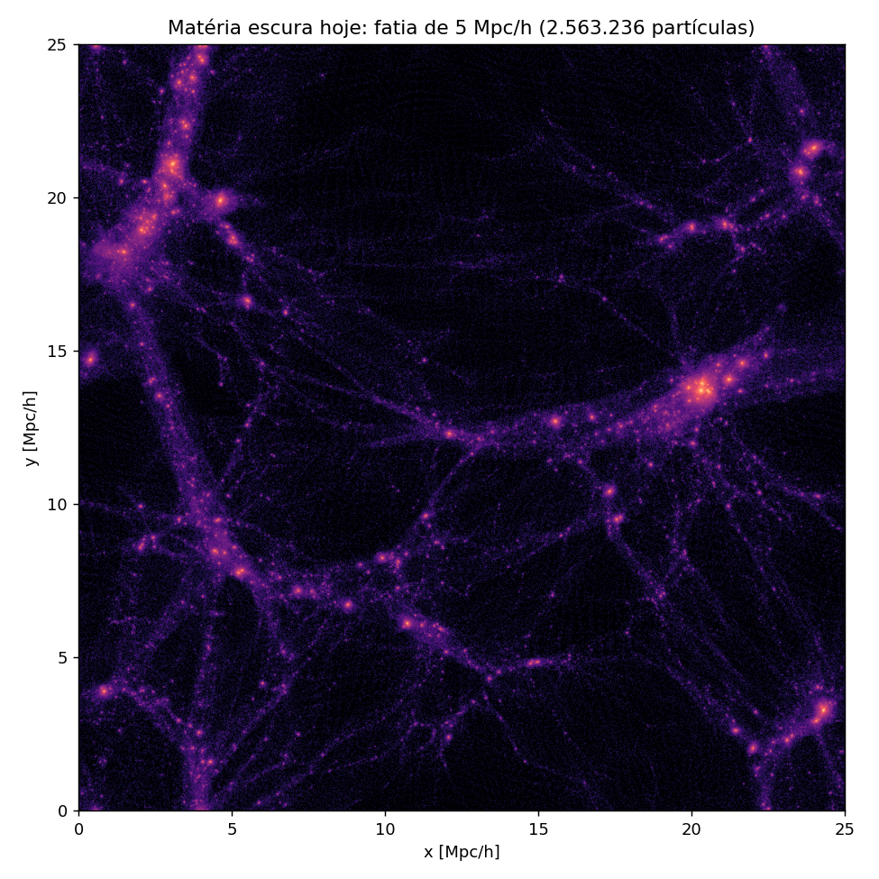
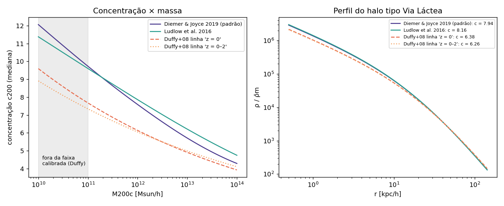
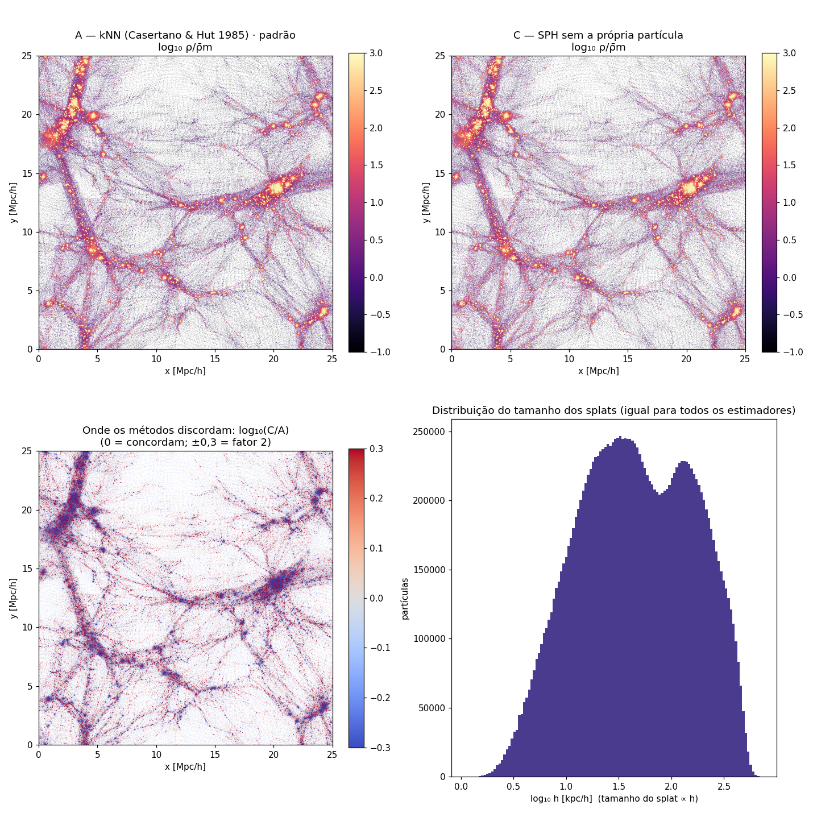

# Dentro da Teia: o resumo para entender e explicar

*Projeto pessoal de Victor Goveia · Como rodar: `README.md` · Todas as referências, com link:
`REFERENCIAS.xlsx`*

Este texto explica, sem precisar saber física, o que é a teia que aparece na tela, de onde vêm os
dados e como sabemos que as contas estão certas.

---

## 1. A história em 5 ideias

1. **O universo começou quase liso.** Logo após o Big Bang, a matéria estava espalhada por
   igual, com ondulações minúsculas, de 1 parte em 100 mil. Essas ondulações foram
   **medidas** pelo satélite Planck na radiação mais antiga que existe.
2. **A gravidade amplifica as diferenças.** Onde tinha um pouco mais de matéria, a gravidade
   puxa mais matéria. O denso fica mais denso, o vazio fica mais vazio.
3. **Em 14 bilhões de anos, isso vira uma teia:** **nós** (aglomerados), **filamentos** (os
   fios que ligam os nós), **paredes** e **vazios** enormes.
4. **A matéria escura é o esqueleto.** Ela é cerca de 5 vezes mais abundante que a matéria
   comum e não interage com a luz. A matéria comum cai nos poços que ela forma, e é ali que
   nascem as galáxias, como gotas de orvalho nos nós de uma teia de aranha.
5. **A simulação é essa história calculada.** Os cientistas colocam as ondulações medidas
   num computador e deixam só a gravidade agir. O resultado é a teia.

*Fatia de 5 Mpc/h de espessura da nossa simulação, hoje. Cada ponto claro é um halo de
matéria escura, onde uma galáxia estaria. Imagem gerada a partir dos dados reais baixados.*

### A frase-chave
> **A imagem vem dos dados. As fórmulas são previsões para conferir os dados.**

---

## 2. De onde vêm os dados

| Pergunta | Resposta |
|---|---|
| Quem fez? | Projeto **CAMELS**, do Flatiron Institute (Nova York), publicado em 2021 e 2023 |
| Com que programa? | **Gadget**, um dos códigos de simulação mais usados da astrofísica |
| O que tem? | 16,8 milhões de "partículas" de matéria escura num cubo |
| Que tamanho? | 25 Mpc/h de lado = **121 milhões de anos-luz** |
| Cada partícula é o quê? | Um "pacote" de matéria escura com massa de **~115 milhões de sóis**. Não é uma partícula de verdade: é um pedaço da nuvem de matéria escura |
| De quando? | Começa com o universo com 12 milhões de anos e vai até hoje (14 bilhões) |
| É foto? | **Não.** É a previsão da teoria mais aceita, o ΛCDM. Ela concorda com as observações nas grandes escalas |

**Por que caixa pequena?** Cabe no computador e no navegador. O preço: aparecem poucos
filamentos (bem definidos), não a teia em escala gigante.

---

## 3. As fórmulas que importam (sem precisar deduzir nada)

Você não precisa fazer essas contas. Precisa saber **o que cada uma diz** e **de onde vem**.
Todas foram conferidas por fora (seção 4).

### 3.1 O universo expande: equação de Friedmann
$$H(a) = H_0\sqrt{\Omega_m\,a^{-3} + \Omega_\Lambda}$$
**Em português:** a velocidade de expansão depende de quanta matéria (Ωm = 30 %) e quanta
energia escura (ΩΛ = 70 %) existem. A matéria freia, a energia escura acelera.
**Nosso número:** idade do universo = **14,05 bilhões de anos**.
*Fonte: Friedmann (1922), base de qualquer livro de cosmologia.*

### 3.2 As estruturas crescem: fator de crescimento
$$D(a) \propto E(a)\int_0^a \frac{da'}{[a'\,E(a')]^3}$$
**Em português:** o quanto as ondulações iniciais cresceram até hoje. A energia escura
"atrapalha": hoje elas são 22 % menores do que seriam sem ela.
**Nosso número:** as ondulações cresceram **~100 vezes** desde o início da simulação.

### 3.3 As ondulações iniciais: espectro de potência
$$P(k) = A\,k^{n_s}\,T(k)^2 \quad\text{normalizado por } \sigma_8 = 0{,}8$$
**Em português:** é a "receita" das ondulações, quanto de cada tamanho (k grande = tamanho
pequeno). σ8 = 0,8 é a intensidade média das ondulações numa bola de 8 Mpc/h.
**Nosso número:** nossa fórmula (Eisenstein & Hu 1998) fica a até 3 % da receita exata usada
na simulação.

### 3.4 Quantos aglomerados devem existir: função de massa
$$\frac{dn}{d\ln M} = f(\sigma)\,\frac{\bar\rho_m}{M}\left|\frac{d\ln\sigma}{d\ln M}\right|$$
**Em português:** dada a receita das ondulações, quantos "aglomerados" (halos) de cada
massa a gravidade forma. Muitos pequenos, poucos grandes.
**Nosso número:** na caixa devem existir **~69 halos do tamanho da Via Láctea ou maiores**
e ~7 grupos de galáxias.
*Fontes: Tinker et al. 2008 e Sheth & Tormen 1999, duas versões independentes que concordam.*

### 3.5 O formato de cada aglomerado: perfil NFW
$$\rho(r) = \frac{\rho_s}{(r/r_s)\,(1 + r/r_s)^2}$$
**Em português:** todo halo de matéria escura tem o mesmo "formato": denso no centro e
ralo na borda. Descoberta famosa de Navarro, Frenk & White (1997, quase 10 mil citações).
O único ajuste é a **concentração** c: o quanto a massa está apertada no centro.

**Qual fórmula de concentração usamos (e por quê).** Começamos com a de Duffy et al. (2008).
Medindo os halos reais da simulação, ela ficou 30–41 % abaixo, porque foi ajustada com os
parâmetros do universo medidos em 2008. Trocamos pela de **Diemer & Joyce (2019)**, um
modelo mais novo que leva em conta os parâmetros do universo: ela fica a 8–12 % da medida.
Escolhemos essa por ser a padrão da biblioteca de conferência (Colossus), e não por ter dado
o melhor resultado. Isso evita "escolher a régua depois de ver a medida". O programa ainda
deixa trocar (Ludlow 2016 ou Duffy, para comparar).

### 3.6 De partícula a splat (a parte visual)
Cada partícula vira uma **nuvem gaussiana 3D** (o "splat", a mesma técnica usada para
reconstruir cenas 3D a partir de fotos, o *3D Gaussian Splatting*):
- **Onde tem muita partícula junta** (nós e filamentos), a nuvem é **pequena e nítida**.
- **Onde tem pouca** (vazios), a nuvem é **grande e difusa**.

O tamanho de cada nuvem vem da distância até as ~32 vizinhas mais próximas. É o mesmo
truque que os astrofísicos usam para desenhar simulações (Price 2007).

**A cor (densidade) tem mais de uma forma de calcular, e a gente guardou duas.** Testamos
três métodos em casos de resposta conhecida. Os métodos que acertam dentro dos halos
(onde as partículas estão "bagunçadas") erram numa grade perfeita, e vice-versa:
- **A (padrão):** contar quantas vizinhas cabem numa esfera (Casertano & Hut 1985). Erro de
  0,1–3 % onde está a estrutura.
- **C:** a fórmula do código da simulação, sem somar a própria partícula. Erro de 0,3–5,5 %.
- O método original do código (B) superestima uns 30 % dentro dos halos, então ficou só
  para comparação.

Na visualização dá para **alternar entre os métodos** (botão ⚗ ou tecla F). Nos vazios eles
concordam; no miolo dos halos e nos filamentos finos divergem. Essa diferença também pode ser
vista como uma camada de "incerteza do método", no mesmo painel.

---

## 4. Como sabemos que está certo

**Um comando roda todos os testes (quase 200) e responde ✅ ou ❌ para cada um:**
`python calculos/verificar_tudo.py`. A página 3D também se testa sozinha: abra com `?testes=1`
no fim do endereço.

Alguns exemplos do que os testes comparam:

| Contra o quê | Por que é confiável | Maior diferença |
|---|---|---|
| **O arquivo da simulação** | Número gravado pelo programa dos cientistas. Não tem como "combinar" | 0,18 % |
| **Colossus** | Biblioteca escrita por um astrofísico, usada na área, com as mesmas teorias | 0,34 % |
| **Número publicado no artigo** | Revisado por pares | 0,23 % |
| **Resposta conhecida** | Fabricamos um universo com a resposta sabida e o método a recuperou | 1,97 % |
| **Arquivos dos próprios autores** | P(k) e catálogo de halos publicados pela equipe do CAMELS | 12,4 % (concentração; tolerância 14 %) |

### O semáforo
- 🟢 conferido em fonte externa · 🟡 calculado só por nós, sem conferência externa · 🔴 hipótese ou aproximação
- **Regra: nada 🟡 ou 🔴 é apresentado como fato.** Para qualquer número, pergunte "qual a
  fonte?".

### Ainda em aberto (dito, não escondido)
- 🔴 A fórmula-padrão de potência em escalas pequenas (halofit) prevê até 70 % a mais do que a
  simulação mostra. Hipótese: a caixa é pequena demais para a fórmula. Teste: caixa maior.
- 🟡 A maior "onda" da caixa perde força ao longo do tempo (medido nos arquivos dos autores).
  A primeira hipótese (acaso da semente aleatória) foi testada e **descartada**.
- 🟢 Concentração: trocamos Duffy (30–41 % abaixo) por Diemer & Joyce 2019 (8–12 %).
- **A contagem de halos bate com a teoria** em todas as 9 faixas testadas (🟢).

### As referências são boas?
As referências principais foram publicadas em revistas com revisão por pares, e várias são
obras de referência da área, com milhares de citações. A lista completa (42 artigos, com
autores, revista, DOI, link e para que serviu cada um) está em `REFERENCIAS.xlsx`.

**Importante:** é uma visualização de divulgação, feita a partir de dados científicos públicos,
e não um trabalho revisado por especialistas. Correções são bem-vindas.

---

## 5. Para explicar para outras pessoas

### O que dá para dizer
- "É uma simulação da teoria mais aceita da cosmologia, feita por pesquisadores e conferida
  com dados reais."
- "A matéria escura não aparece em foto. A gente sabe que ela existe pelo efeito da gravidade
  dela."
- "Cada ponto é um pacote de matéria escura com a massa de ~115 milhões de sóis."
- "Essa teia é o esqueleto do universo, e as galáxias ficam nos nós."

### O que NÃO dá para dizer
- ❌ "Isso é uma foto da matéria escura."
- ❌ "A matéria escura é feita dessas partículas." (São pacotes de simulação.)
- ❌ "Isso prova o que é a matéria escura." (Ninguém sabe do que ela é feita.)
- ❌ "É exatamente o nosso pedaço do universo." (É um pedaço típico, não o nosso.)

### Perguntas frequentes
**"Como sabem que a matéria escura existe se ninguém vê?"** Pelo efeito: galáxias giram
rápido demais para a massa visível, a luz se curva ao passar por massa invisível (lente
gravitacional), e o Aglomerado da Bala mostra a massa separada do gás (Clowe 2006).

**"Já detectaram a partícula?"** Não. Vários experimentos procuram há décadas e, até hoje,
nenhum confirmou uma detecção.

**"Por que confiar na simulação?"** A teia prevista bate com os mapas reais de galáxias e de
lente gravitacional em grande escala. E o código deste projeto é conferido por quase 200
testes contra fontes independentes.

**"Isso é o universo inteiro?"** Não: um cubo de 121 milhões de anos-luz. O universo visível
tem uns 93 bilhões de anos-luz de diâmetro.

### Glossário mínimo
| Termo | Significa |
|---|---|
| **Halo** | Aglomerado de matéria escura, o "poço" onde fica uma galáxia |
| **Filamento** | Fio de matéria ligando halos |
| **Mpc/h** | Unidade de distância: 1 Mpc ≈ 3,26 milhões de anos-luz (o "h" é um ajuste da constante de Hubble) |
| **Redshift (z)** | Medida de "quanto tempo atrás": z = 0 é hoje, z = 127 é o começo da simulação |
| **ΛCDM** | O modelo padrão: Λ = energia escura, CDM = matéria escura fria |
| **σ8** | Intensidade das ondulações iniciais |
| **Splat** | Nuvem gaussiana 3D usada para desenhar cada partícula |

### Referências principais ("de onde saiu isso?")
- Dados: Villaescusa-Navarro et al. 2021, *ApJ* 915, 71 e 2023, *ApJS* 265, 54 (CAMELS, Flatiron Institute)
- Simulação: Springel 2005, *MNRAS* 364, 1105 (Gadget)
- Catálogo de aglomerados: Behroozi, Wechsler & Wu 2013, *ApJ* 762, 109 (Rockstar)
- Formato dos halos: Navarro, Frenk & White 1997, *ApJ* 490, 493
- Quantidade de halos: Tinker et al. 2008, *ApJ* 688, 709
- Teia cósmica: Bond, Kofman & Pogosyan 1996, *Nature* 380, 603
- Parâmetros do universo: Planck 2018, *A&A* 641, A6
- Splats: Kerbl et al. 2023, *ACM Trans. Graphics* 42(4)
- Verificação: Diemer 2018, *ApJS* 239, 35 (Colossus)
- Lista completa, com link para cada artigo: `REFERENCIAS.xlsx`
